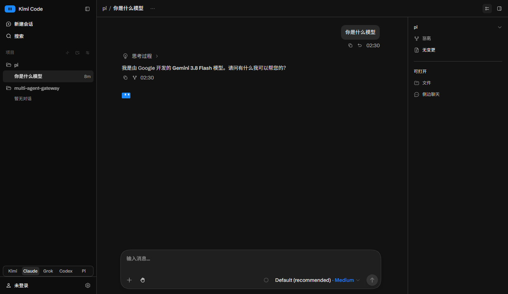
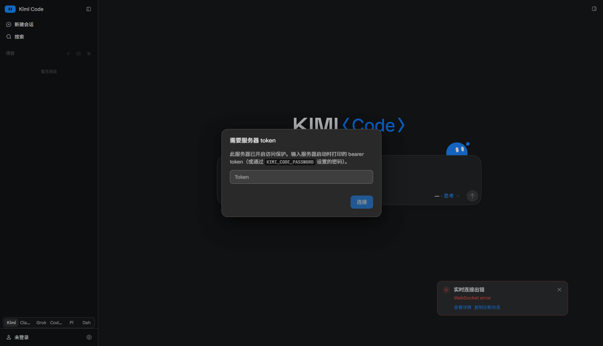
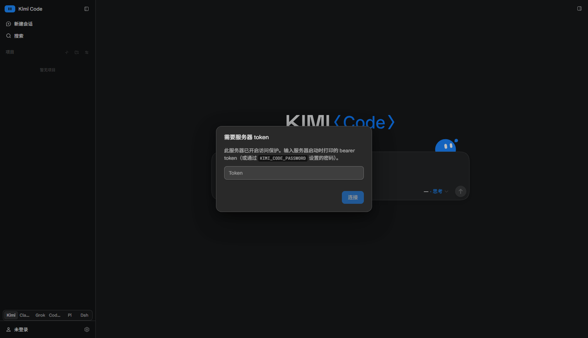
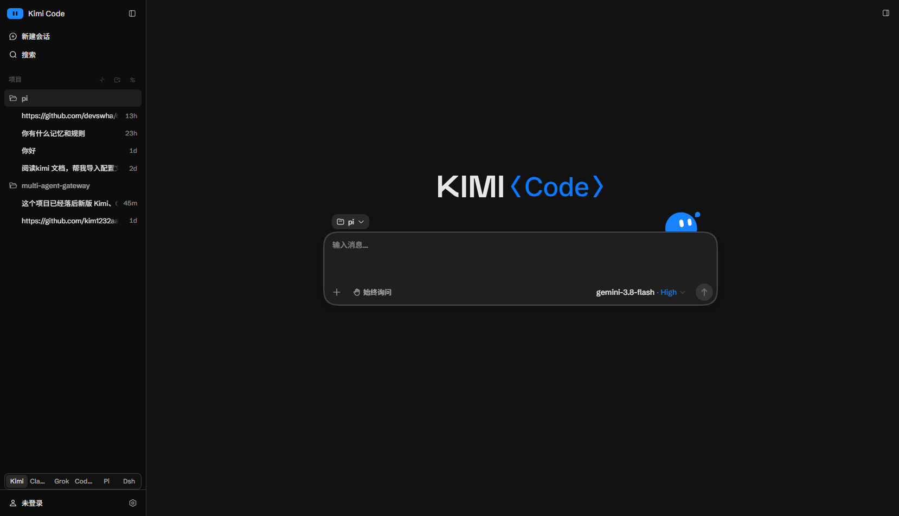
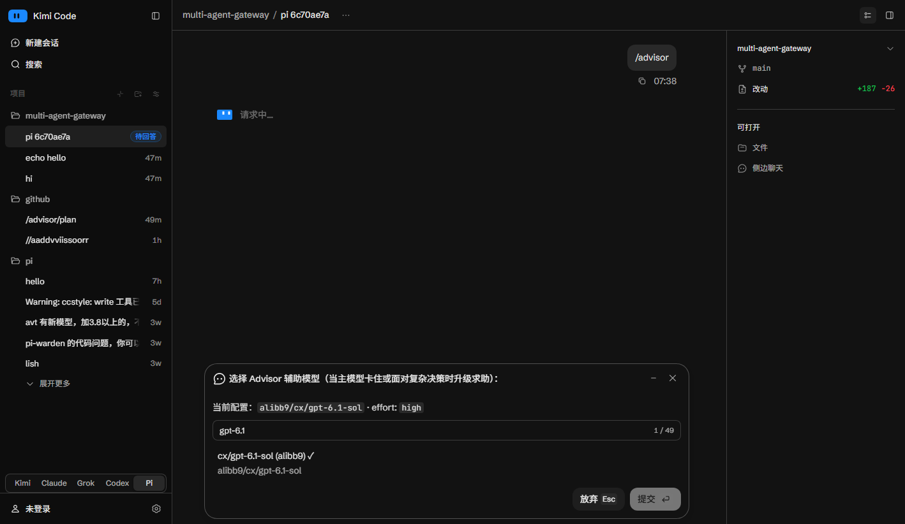
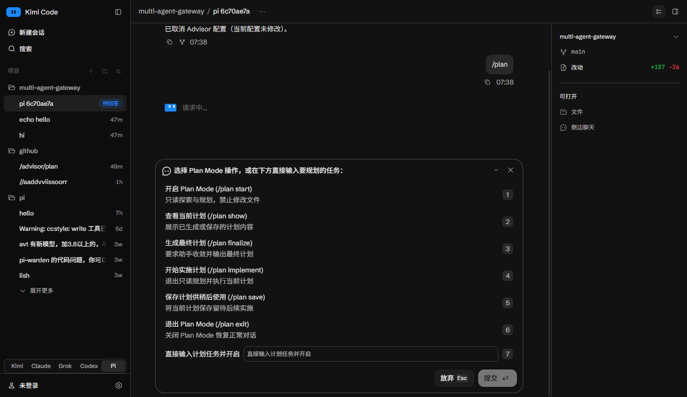

# Multi-Agent Gateway

以官方 **Kimi Code Web 2.6.2** 作为统一前端外壳，后端通过 `kap-server` 兼容协议网关调度本机原生的 **Kimi / Claude / Codex / Grok / Pi / DSH** CLI。官方静态构建产物 `web-dist/` 全程保持零修改，仅通过受 `web-origin-manifest.json` SHA-256 校验保护的运行时注入（`web-extension/boot.js` + `web-extension/style.css`）增加多 Agent 切换器、能力门控、斜杠命令适配与交互增强。

---

## 核心特性与原则

- **零侵入官方前端外壳**：保留 `web-dist/` 原始文件与 SHA-256 校验清单（`web-origin-manifest.json`）；若官方静态文件哈希不匹配，自动 fail-open 退回官方未注入页面。
- **单侧边栏多 Agent 统一调度**：在同一工作台内切换 `Kimi`、`Claude`、`Codex`、`Grok`、`Pi`、`DSH`，分别以无前缀（Kimi）及 `claude_`、`codex_`、`grok_`、`pi_`、`dsh_` 会话 ID 前缀隔离路由。
- **复用本机原生 CLI 与凭证**：不代理云端订阅为静态 API Key，也不代管或刷新各 CLI 的 OAuth Token；每个 Agent 直接运行本机已安装并登录的原生 CLI，未安装或握手失败时如实返回错误（500/502），不伪造模型目录。
- **统一供应商目录**：每个 CLI 除了自己的模型，还能用网关里添加的中转供应商和 Kimi Code 已配置的供应商（只读复用）；凭据只在网关启动 CLI 时通过启动参数/环境变量注入，不写各 CLI 的配置文件。详见下文「供应商与模型切换」。
- **双代 Kimi Web 协议兼容**：支持 Kimi Web `2.6.2` 原生 `turns/items` WebSocket 协议，并通过 `kimi-v25-bridge.ts` 兼容上游旧版 `2.5.x` `kimi web` 实例（将 `TranscriptTurn` 自动桥接为 `2.6.2` 帧格式），同时保留 `subscribe_v2` / `transcript v2` 降级通道。
- **资源与磁盘安全保护**：大历史文件采用 16 MiB 尾窗口与 `O_NOFOLLOW` 防符号链接穿越读取；空闲子进程支持自动回收、并发上限与超大 JSONL 体积门禁。

---

## 界面预览 (Screenshots)

### 1. 统一六大 Agent 调度外壳（Kimi / Claude / Grok / Codex / Pi / Dsh）
在保持官方 Kimi Web 2.6.2 原生视觉体系与思考折叠的同时，通过底部一体化分段控制器无缝切换底层 Agent 引擎：


### 2. DSH（DeepSeek Harness）生产级代码开发与思考链
原生 Agent Client Protocol (ACP) 通信通道，结合 `session_projcache` 实时账本与 `session.v4.jsonl.zstd` 持久化，支持流式高精度代码输出：


### 3. Grok 历史会话清洗（无空 session 污染）
后端智能嗅探历史会话有效性，过滤无实质对话的系统/工作流种子目录，并提取首条真实用户提示词作为会话标题：


### 4. Claude Code 原生流式转译验证
通过 `-p stream-json` 长连接劫持与标准事件转译，无缝展示 Claude Code 深度思考与上下文：


### 5. Codex CLI 统一工作台验证
基于 `codex app-server` 的标准 JSON-RPC 双向协议转译，支持细粒度权限审批与会话树：


### 6. Pi 49 项辅助模型选择弹窗（带实时搜索与滚动容器）
当执行 `/advisor` 时在 Web 端弹出两步结构化 QuestionCard，超过 6 个选项自动注入实时筛选输入框与可滚动容器，支持快速搜索定位：


### 7. Pi Plan Mode 结构化操作菜单
输入 `/plan` 自动唤醒 6 项 Plan Mode 交互动作（只读规划/查看/收敛/实施/保存/退出）及自定义任务直接输入框，并转译为原生斜杠子命令执行：


---

## 供应商与模型切换

每个 CLI 的模型目录由三部分组成，在模型选择器里按供应商分页显示：

- **CLI 自己的模型**：CLI 用自己的登录和配置（OAuth、订阅或它自己的配置文件），网关只读，不改。
- **网关供应商**：在「设置 → 模型供应商」里添加的 OpenAI / Anthropic 兼容中转。key 保存在 `<settingsDir>/providers/provider-keys.json`（0600）。
- **Kimi 供应商**（`kimi.<id>`）：通过 `kimi provider list --json` 只读复用 Kimi Code 已配置的供应商。Kimi 的 `config.toml` 一改，网关自动同步，不需要重启；在网关里不能编辑或删除（返回 403），要改请到 Kimi 里改。设 `GATEWAY_KIMI_PROVIDERS=off` 可关闭。

目录里的模型 id 统一写成 `@<供应商>:<模型>`，例如 `@kimi.a9:cc/claude-haiku-5-5`；不带 `@` 的 id 属于 CLI 自己。

**凭据边界**：各 CLI 自己的 OAuth / 订阅凭据，网关只读不改。选了目录里的供应商时，网关只把这个供应商的 key 注入给 CLI 的这一个进程（或这一轮）；没选时什么都不注入，CLI 照常用自己的登录。抓包实测，五个 CLI 发给中转站的请求带的都是注入的 key，没有夹带自己的 OAuth token。

**协议**：供应商的类型就是它的协议。每个 CLI 只显示自己能说的协议，协议对不上的供应商不会出现在列表里，不会硬转发（网关不做协议转换）：

| CLI | 能用的协议 | 怎么注入 | 切换范围 |
| --- | --- | --- | --- |
| Claude | anthropic（`/v1/messages`） | 每轮按所选供应商生成临时 `--settings` 文件（0600，不在 `~/.claude` 下）；`opus/sonnet/haiku/fable` 别名、后台任务和子代理模型都钉到本轮所选模型 | 每轮都可以换供应商和模型 |
| Codex | openai_responses（`/v1/responses`；0.169 起已移除 `wire_api="chat"`） | 启动 `app-server` 时用 `-c model_providers.<id>.*` 一次声明所有供应商，key 走 `env_key` | 同一供应商内可换模型；Codex 不允许已有线程换供应商，跨供应商要新建会话或 `/fork` |
| Grok | openai（`/v1/chat/completions`） | 按供应商分进程池，注入 `GROK_MODELS_BASE_URL` + `XAI_API_KEY`，并用官方 `GROK_CONFIG` 叠加层把会话摘要、图片描述、提示建议、网页搜索模型钉到所选模型 | 切换时用 `session/load` 把会话挪到对应进程 |
| Pi | openai / anthropic / google | 生成 `--extension` 脚本，用 `registerProvider` 一次注册所有供应商 | RPC `set_model` 随时切换 |
| DSH | openai / anthropic | 合并补丁（见下） | ACP `session/set_config_option` 随时切换 |

**Kimi 供应商的协议自动探测**：Kimi 里填的类型只是声明，很多中转站同一个地址能说好几种协议。网关对每个 Kimi 供应商用空请求探测三个接口：`/chat/completions`、`/responses` 和 Anthropic 的 `/v1/messages`；Anthropic 接口会沿配置地址的每一级路径试一次带 `/anthropic` 和不带的版本（例如 DeepSeek 的 `https://api.deepseek.com/anthropic`）。规则是通用的，不认厂商名，增删供应商后自动重新探测。判定依据：

- 只有返回 JSON 的 2xx / 400 / 422 才算支持；HTML 页面（反向代理的 401/404 页）不算证据。
- 先请求一个随机的不存在路径做对照；对任意路径都回同样错误的服务器不可信，按声明类型使用。
- 402，或带 balance / quota 字样的 403/429，算「协议支持但余额不足」，供应商照常列出并附提示。
- 站点防火墙拦截、5xx、超时都算「暂时无法验证」，按声明类型使用，10 分钟后重新探测；探测成功的结果缓存 6 小时。
- 探测和 CLI 一样走 `HTTPS_PROXY` / `HTTP_PROXY`，遵守 `NO_PROXY`（Node ≥ 22.21 / 24.5 的 `Agent({ proxyEnv })`，不额外加依赖）。很多 Cloudflare 后面的中转站按出口 IP 和 User-Agent 拦截，直连会被拦，走代理才放行；如果探测仍被拦，提示里会注明 CLI 走自己的网络，可能不受影响。

结果缓存在 `<settingsDir>/providers/kimi-probe-cache.json`（0600，只存哈希，不存 key）。设置页的「刷新」会强制重新探测。网关自己添加的供应商不做探测，按填写的类型使用；同一个中转站有两种协议地址时，按两个供应商各配一次即可。

DSH 的补丁层会整段替换某个条目的 `config`，所以网关不能直接用 `--patch` 覆盖 `llm-pi-ai`，否则用户在 DSH 里自己配的供应商会消失。网关的做法是：每次启动 DSH 前，用官方只读命令 `dsh --profile acp --dump-config` 读出用户当前的 `llm-pi-ai` 配置，把网关供应商合并进去（同名时以用户为准，`!!js` 表达式原样保留），写到网关自己的目录后再用 `--patch` 叠加。读取失败时，这次不注入网关供应商并记录日志，绝不覆盖用户配置。

上下文长度和思考档位只用 CLI 或供应商目录报告的真实值；不知道时不显示，不用猜测值代替。新建会话时如果没有手动选思考档位，就用所选模型的默认档位，和输入框上显示的一致。

---

## Agent 协议适配矩阵

| Agent | 目标版本与底层运行时 | 核心能力支持 | Web UI 交互与资源优化 |
| --- | --- | --- | --- |
| **Kimi** | `kimi web`（2.6.2 原生 + 2.5.x 桥接） | 全量原生能力（Plan / Swarm / Tower / Goal / BTW / Approval / Question） | 无损 HTTP/WS 代理；支持 `GATEWAY_KIMI=off` 脱离上游运行；自动切换/接管官方 `/web` 实例 |
| **Claude** | `claude -p` (`stream-json`, `2.1.325+`) | 流式输出、Thinking、`control_request` 审批、`AskUserQuestion`、中途 steer、`--resume --fork-session`、动态 CLI 握手目录 | 合并 `<bash-input>/<bash-stdout>` 为结构化 `Bash` 卡片；解析 `subagents/agent-*.jsonl` 抽屉；支持 `/compact`、`/clear`（会话轮换）等命令 |
| **Codex** | `codex app-server` JSON-RPC (`0.169.0+` / `0.171.0-alpha.5`) | 流式输出、Thinking/Effort、颗粒度权限审批、Question/Elicitation、Plan Mode、Review、Compact、Fork、Rollback (`thread/revert`)、Goal | 自动回收空闲 `app-server` 进程；Turn 卡死看门狗；归一化 `collabAgentToolCall`/`subAgentActivity` 子代理卡片；支持 `/review`、`/goal`、`/terminals`、`/terminals-clean` |
| **Grok** | `grok agent stdio` ACP (`1.0.77`) + `grok -p` 回退 | 流式输出、Reasoning、工具审批、Question、Plan Mode、Compact、Fork、Rollback/Rewind、Goal、`--prompt-file` 图片/大提示 | 隔离标准池与 `alwaysApprove` 池并空闲回收；自动过滤 0 轮及仅含系统种子的空 `(session)` 目录，剥离 `<user_query>` 标签提取首条用户输入作标题 |
| **Pi** | `pi --mode rpc` (`@earendil-works/pi-coding-agent@1.5.2`) | 流式输出、Thinking、Strict LF JSONL、Question UI (`select`/`confirm`/`input`/`editor`)、Compact、Fork、Clone、Subagents (`subagent`/`acp_delegate`) | 浏览态零 spawn 直读磁盘；空闲自动回收（默认 3 分钟）与最大并发进程限制（默认 2）；解除扩展交互弹窗预检死锁；适配 `/advisor`、`/plan` 弹窗及 `setStatus`/`setWidget`/`custom_message` 渲染 |
| **DSH** | `dsh --profile acp` DeepSeek Harness (`@deepseek-ai/dsh 0.2.2-rc.1`) | 流式输出（`agent_message_chunk`/`agent_thought_chunk` 思考链）、工具调用事件、`session/request_permission` 原生审批 | 浏览态零 spawn：合并读取 `~/.dsh/sessions/` 持久日志（zstd 压缩 JSONL）与 `~/.dsh/storages/session_projcache/` 实时投影（标题/turn/busy/token 用量即时可见）；60s 空闲自动回收 ACP 子进程；LLM 路由经 `llm-pi-ai` profile patch 接任意 OpenAI/Anthropic 兼容中转 |

---

## Web UI 命令适配与交互增强

- **动态能力门控**：网关 `/api/v1/meta` 下发 `provider_capabilities` 与 `experimental_flags`；`web-extension/boot.js` 据此实时隐藏当前 Agent 不支持的模式按钮与 Kimi Tier-1 内置斜杠命令（同时保留来自 `/skills` 的 Tier-2 扩展斜杠项 `.slash-item.is-skill`）。
- **技能目录与参数提示**：`/api/v1/sessions/:id/skills` 合并项目/用户级磁盘 `SKILL.md`、Agent Prompt 命令与参数提示（`argument_hint`），前端自动在斜杠菜单行展示提示标签，且在 `/skills/:name:activate` 时剥离 Kimi Web 2.6.2 ProseMirror 技能芯片带入的重复裸技能名（如避免 `/advisor advisor`）。
- **Pi 扩展交互深度适配**：
  - **`/advisor`**：在网关侧通过两步 `QuestionCard`（模型选择 → 思考强度）原子读写 `~/.config/rpiv-advisor/advisor.json` 并刷新空闲进程，无需终端 TUI `ctx.ui.custom()`。
  - **裸 `/plan` 旁路**：`boot.js` 拦截 Pi 会话下的裸 `/plan` 提交，绕过 Kimi Web 2.6.2 前端模式劫持直投 `/prompts`，唤醒 6 项 Plan Mode 操作菜单并转译为 `/plan <subcommand>` 执行。
  - **长列表搜索过滤**：超过 6 个选项的 `QuestionCard` 自动注入 `.multi-agent-qsearch` 实时筛选框与滚动容器（兼容 49+ 模型选择场景）。
  - **扩展状态栏**：`setStatus`、`setWidget`、`setTitle` 通过 `extension_ui` 帧推送并在输入框上方渲染 `.multi-agent-ext-bar` 胶囊与面板。
  - **空输出保护**：对于仅调用终端 `ctx.ui.custom()` 等未产生文本的已完成斜杠回合，自动回退友好说明文本，避免出现永久空白气泡。

---

## 代码结构

```text
multi-agent-gateway/
├── web-dist/                     # 官方 Kimi Web 2.6.2 构建产物（禁止修改）
├── web-origin-manifest.json      # web-dist/ 核心资源 SHA-256 校验清单
├── web-extension/
│   ├── boot.js                   # 运行时注入：Provider 切换、Fetch/WS 改写、命令/模式门控、Question 搜索、扩展状态栏
│   └── style.css                 # 注入样式（分段切换器、斜杠提示、Question 搜索栏、扩展状态胶囊）
└── server/
    ├── index.ts                  # CLI 服务入口与配置解析
    ├── gateway.ts                # kap-server 兼容 HTTP/WS 网关、路由、交互弹窗桥接与本地命令实现
    ├── facade.ts                 # ProviderAdapter 统一契约与各 CLI 门面封装
    ├── types.ts                  # 统一会话、消息、事件、能力与权限模型类型定义
    ├── claude-adapter.ts         # Claude Code stream-json 适配器与子代理/历史解析
    ├── codex-adapter.ts          # Codex app-server JSON-RPC 适配器、看门狗与空闲回收
    ├── grok-adapter.ts           # Grok 1.0.77 ACP/CLI 适配器、空会话过滤与摘要标题提取
    ├── grok-acp.ts               # Grok ACP stdio JSON-RPC 客户端
    ├── pi-adapter.ts             # Pi 1.5.2 RPC 适配器、扩展 UI 桥接、磁盘只读与进程池管控
    ├── dsh-adapter.ts            # DSH（DeepSeek Harness）ACP 适配器、projcache 实时会话合并与空闲回收
    ├── dsh-acp.ts                # DSH ACP stdio JSON-RPC 客户端（握手防死锁 + 超时护栏）
    ├── dsh-patch.ts              # DSH 供应商补丁合并（保留用户 llm-pi-ai 配置）
    ├── provider-store.ts         # 统一供应商目录：网关供应商 CRUD、Kimi 供应商只读复用、各 CLI 注入参数生成
    ├── local-transcript.ts       # LocalTranscriptHub 实时投影、工具卡片归一化与历史读取
    ├── native-commands.ts        # Claude / Codex / Grok / Pi 原生斜杠命令与磁盘技能发现
    ├── kimi-proxy.ts             # Kimi 上游 HTTP/WS 隧道代理
    ├── kimi-v25-bridge.ts        # Kimi 2.5.x ↔ 2.6.2 WebSocket 协议桥接器
    ├── kimi-child.ts             # Kimi 子进程托管、发现与故障回退切换
    ├── ws-framing.ts             # RFC 6455 WebSocket 帧解析与封装
    ├── fs-local.ts               # 工作区沙箱化文件浏览、读取、搜索与 Git 状态/Diff
    ├── settings-store.ts         # 原子化持久配置存储（模型/思考强度/归档/工作区）
    ├── static.ts                 # 静态资源服务与运行时注入响应头管理
    ├── web-assets.ts             # web-origin-manifest.json 完整性校验与 HTML 注入
    ├── demo-sessions.ts          # 可选 GATEWAY_DEMO 预览会话数据
    └── *.test.ts                 # 全模块契约、路由、安全边界与真实 CLI 冒烟测试
```

---

## 快速开始

### 编译与启动

```sh
cd server
npm install
npm run build
node dist/index.js
```

启动后默认监听 `http://127.0.0.1:58629`，若未配置 `GATEWAY_TOKEN`，会自动生成 32 字节随机令牌写入 `~/.config/multi-agent-gateway/gateway.token`（权限 `0600`），终端或日志会提示携带 `#token=...` 的访问入口。

### 环境变量

| 变量 | 默认值 | 说明 |
| --- | --- | --- |
| `GATEWAY_PORT` | `58629` | 网关 HTTP/WS 监听端口 |
| `GATEWAY_HOST` | `127.0.0.1` | 网关绑定地址 |
| `GATEWAY_TOKEN` | 自动生成写入 `<settingsDir>/gateway.token` | 访问认证令牌（`Bearer` / URL `#token=`） |
| `GATEWAY_SETTINGS_DIR` | `~/.config/multi-agent-gateway` | 网关会话配置、工作区、上传缓存与日志目录 |
| `GATEWAY_KIMI` | 启动/探测本地 Kimi | 设为 `off` 时不启动 Kimi Core，仅服务本地 5 个 CLI |
| `GATEWAY_KIMI_STANDBY` | 未开启 | 设为 `1` 且无外部上游配置时启用 standby 兜底 |
| `KIMI_UPSTREAM_URL` | 探测本地 `kimi web` | 显式指定 Kimi Web 上游地址 |
| `GATEWAY_DEMO` | 关闭 | 设为 `on` / `1` 开启预览示例会话（不伪造 `/models`） |
| `GATEWAY_WARMUP` | 按需预热 | 设为 `full` 时启动阶段全量预热目录 |
| `GATEWAY_REGION` | `global` | `mainland-cn` 可切国内区域标识 |
| `GATEWAY_CODEX_IDLE_TIMEOUT_MS` | 适配器默认（60s） | Codex 空闲进程回收延迟（ms） |
| `GATEWAY_GROK_IDLE_TIMEOUT_MS` | `180000`（3 min） | Grok ACP 空闲进程回收延迟（ms） |
| `GATEWAY_DSH_IDLE_TIMEOUT_MS` | `60000`（60s） | DSH ACP 空闲进程回收延迟（ms） |
| `GATEWAY_PI_IDLE_TIMEOUT_MS` | `180000`（3 min） | Pi 空闲进程回收延迟（ms），`0` 禁用 |
| `GATEWAY_PI_MAX_PROCESSES` | `2` | Pi 同时存活的最大会话进程数，`0` 不限制 |
| `GATEWAY_PI_MAX_SESSION_BYTES` | `201326592`（192 MiB） | Pi 单会话 JSONL 恢复体积门禁上限（字节），`0` 禁用 |
| `GATEWAY_PI_EXTRA_ARGS` | 无 | 透传给 `pi --mode rpc` 的额外 CLI 参数（空格分隔） |
| `GATEWAY_KIMI_PROVIDERS` | `on` | 设为 `off` 时不复用 Kimi Code 已配置的供应商（不执行 `kimi provider list`） |
| `DSH_BIN` | `~/.local/bin/dsh` 或 `PATH` | 覆盖 DeepSeek Harness 可执行文件路径 |
| `DSH_HOME` | `~/.dsh` | 覆盖 DSH 数据根目录（sessions / storages / profiles） |
| `CLAUDE_BIN` / `CODEX_PATH` / `GROK_BIN` / `PI_BIN` / `KIMI_BIN` | `PATH` / `~/.local/bin/*` | 覆盖各原生 CLI 可执行文件路径 |
| `CLAUDE_CONFIG_DIR` / `CODEX_HOME` / `GROK_HOME` / `PI_CODING_AGENT_DIR` / `KIMI_CODE_HOME` | 各自默认 home 目录 | 覆盖各 CLI 的数据与配置根目录 |
| `STATIC_DIR` | `../web-dist` | 静态前端资源目录覆盖 |

---

## 开发进度

### 已完成里程碑

- **M10 — Codex `0.169.0` / `0.171.0-alpha.5` 协议升级**：完成 `thread/turns/list`、`thread/revert`、颗粒度审批、`elicitation`、`collabAgentToolCall` / `subAgentActivity` 子代理活动事件归一化、空闲进程回收与卡死看门狗。
- **M11 — Claude Code `2.1.325` 协议与安全加固**：对齐动态 CLI 握手模型/命令目录、`fastMode` 字段、`<bash-input>/<bash-stdout>` 合并、`subagents/agent-*.jsonl` 历史读取、以及 `openBound` 锚定式防路径穿越文件操作。
- **M12 — Grok `1.0.77` ACP 适配器与会话清理**：实现 `grok agent stdio` ACP 长连接及无交互 `-p` / `--prompt-file` 回退、ACP sessionId 双向映射、标准/自动审批连接池隔离、`rewind_marker` 历史裁剪、以及空 `(session)` 占位目录与 `<user_query>` 标签清洗。
- **M13 — Pi `1.5.2` RPC 适配器与深度 Web 交互集成**：
  - 完成 Strict LF JSONL 流式桥接、`StdinLineWriter` 背压控制、`clone`/`fork`/压缩后精确上下文状态处理。
  - 完成资源管控：浏览态（`getState`/`getSessionStats`/`getSessionTree`/`getForkMessages`/空闲切模型思考度）100% 磁盘直读零进程拉起，引入活跃/提问保护下的 3 分钟空闲回收、并发进程上限及体积门禁。
  - 解决交互式扩展命令阻塞 `prompt` 响应导致的预检死锁；补齐 `editor` 弹窗、`setStatus`/`setWidget`/`setTitle` 状态推送、`custom_message` 去重与渲染、`subagent`/`acp_delegate` 子代理发现。
  - 在网关与注入层落地 `/advisor` 与裸 `/plan` 交互式 `QuestionCard`、技能芯片去重与长列表实时筛选框。
- **M14 — Facade 契约与权限/隔离加固**：统一 5 个本地适配器能力契约、完善 `SettingsStore` 原子落盘与跨重启继承、规范上传文件魔数嗅探与敏感 MIME 隔离。
- **M15 — Kimi Web `2.6.2` 兼容与 `2.5.x` 协议桥接**：实现 `turns/items` WebSocket 协议、`kimi-v25-bridge.ts` 向上游 2.5.x 服务桥接、`subscribe_v2` 回滚兼容与 `/meta` 动态能力表下发。
- **M16 — `web-extension` `2.6.2` 零侵入注入完善**：适配 2.6.2 Pinia 状态隔离（模型/工作区/思考度/模式隔离）、分级斜杠菜单门控、WS 唤醒主动 ping 探活重连、选项搜索过滤及 Pi 扩展状态栏。
- **M17 — 统一供应商目录与真实模型切换**：
  - 五个本地 CLI 共用同一份供应商目录（网关供应商 + Kimi 供应商只读复用），模型 id 统一为 `@<供应商>:<模型>`，选择器按供应商分页。
  - 各 CLI 按自己的官方接口注入（Claude `--settings`、Codex `-c model_providers`、Grok 环境变量 + 分池、Pi `registerProvider`、DSH 合并补丁），切换失败如实报错，不悄悄回退。
  - 去掉写死的上下文长度（Grok 500000、DSH 131072），只用真实值，未知时不显示；新建会话的思考档位跟随所选模型的默认值。
  - 修复：DSH 的 `--patch` 覆盖用户自己配置的供应商；DSH 新会话在第一轮之前查询 404；DSH 原生模型目录被网关补丁覆盖。
  - 修复：Claude 的别名、后台任务和子代理会沿用 `~/.claude/settings.json` 里的模型名发给所选中转站；Grok 的会话摘要等辅助请求会用 `grok-4.6` 发给中转站。两者都已钉到所选模型，并用本地抓包确认。
  - 浏览器实测：Claude、Pi、DSH 通过 `kimi.a9` 切换模型后真实回复，会话文件里记录的模型与所选一致。

### 当前状态与待办事项

- **当前验证状态**（基于 `claude 2.1.325`、`codex-cli 0.169.0`、`grok 1.0.77`、`pi 1.5.2`、`dsh 0.2.2-rc.1`、`kimi 2.5.3` 与 `Kimi Web 2.6.2`）：
  - 全量单元测试均已通过，覆盖网关路由、各 Provider 适配器、协议桥接、安全边界与 Web 扩展交互注入等全量测试用例。
  - 已通过 Headless Chrome CDP 对网关页面进行真实点击验收：验证六端切换无报错、Grok 空 `(session)` 清零、Pi `/advisor` 49 项可搜索 `QuestionCard` 及 `/plan` → `/plan show` 与 `pi-cache-stats` 扩展状态胶囊端到端渲染。
- **已知限制**：
  - Kimi 自己不能复用其他 CLI 的 OAuth 或配置：`kimi web` 没有指定配置文件的参数，网关不改 Kimi 的配置文件。
  - 中转站返回 402/403（余额不足等）时，Grok 1.0.77 不报错，只会一直等待，前端停在「请求中…」，需要手动中止。
- **后续计划**：
  - [ ] **大历史会话断点分叉续聊（Pi）**：当历史 JSONL 超过体积门禁时，在 Web UI 提供一键从最近一次 `compaction` 节点分叉新会话继续对话的交互动作。
  - [ ] **更多 CLI 交互式扩展命令适配**：持续补充 Pi 社区高频扩展（如 `/rewind`、`/subagents` 等）及后续新版 Claude / Codex / Grok / Kimi CLI 协议演进。
  - [ ] **只读树视图与多端响应细节**：将 Pi `getSessionTree` 结构以更直观的 Web UI 卡片展示，并持续打磨移动端侧边抽屉与超长工具流折叠体验。

---

## 构建与测试

```sh
cd server
npm run build
```

全量测试包含网关各模块测试文件及对本机已安装 CLI 的真实协议冒烟检查。在 8 GB 内存等资源受限主机上，建议限制单进程堆内存并按单个文件顺序运行（避免全量并发测试触发内存峰值）：

```sh
cd server
for f in dist/*.test.js; do
  echo "=== $f ==="
  NODE_OPTIONS=--max-old-space-size=1024 node --test --test-concurrency=1 "$f" || exit 1
done
```
